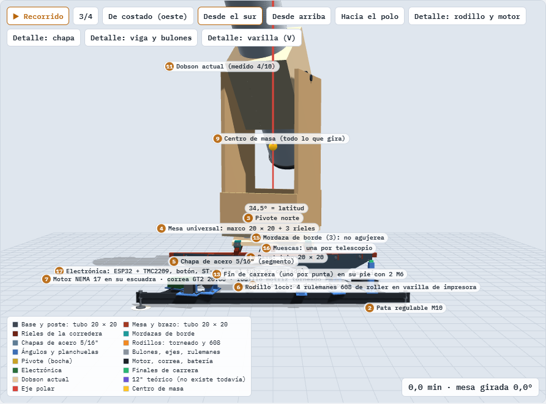
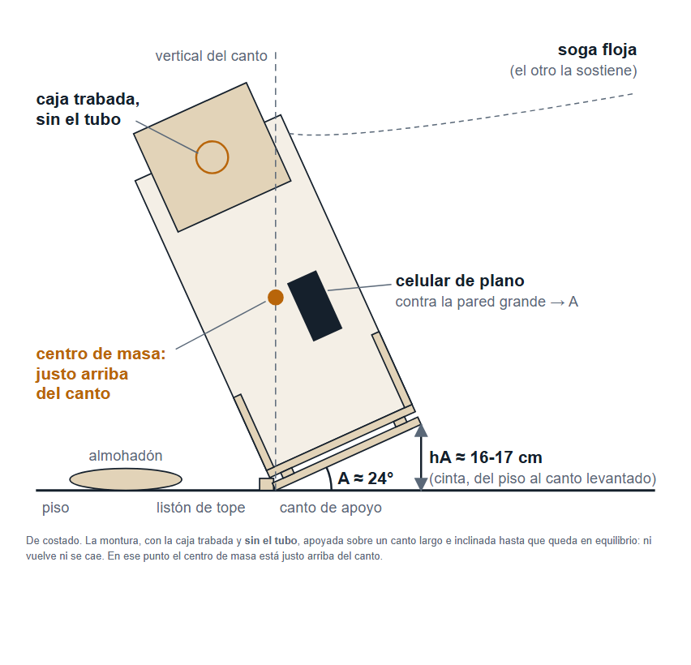
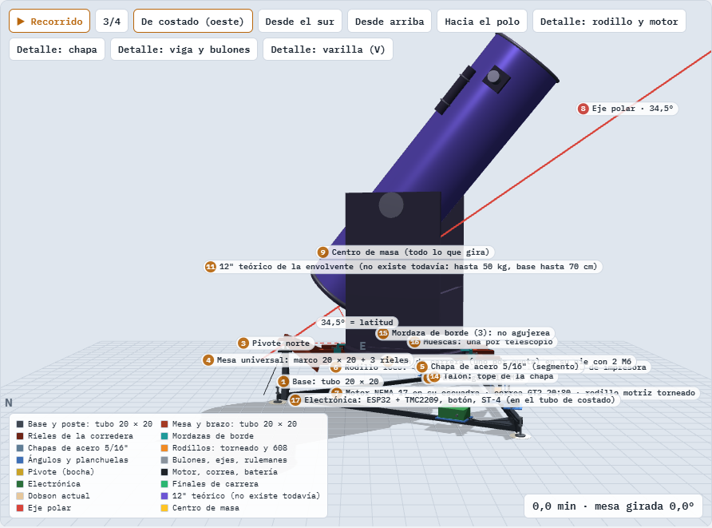
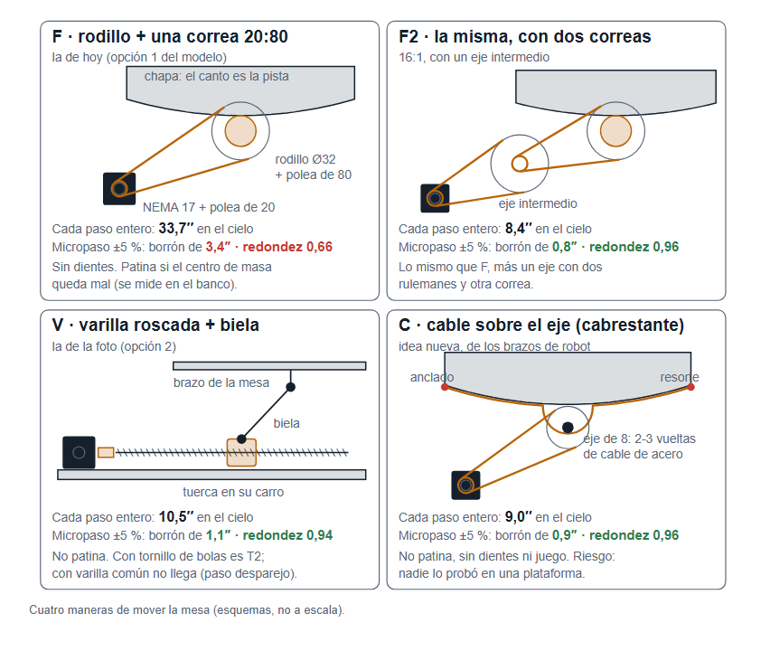
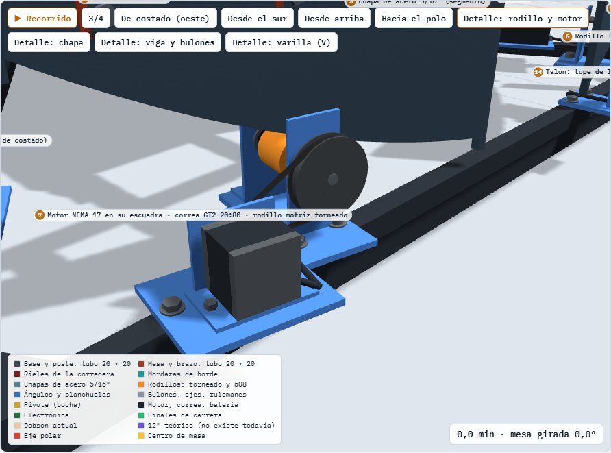
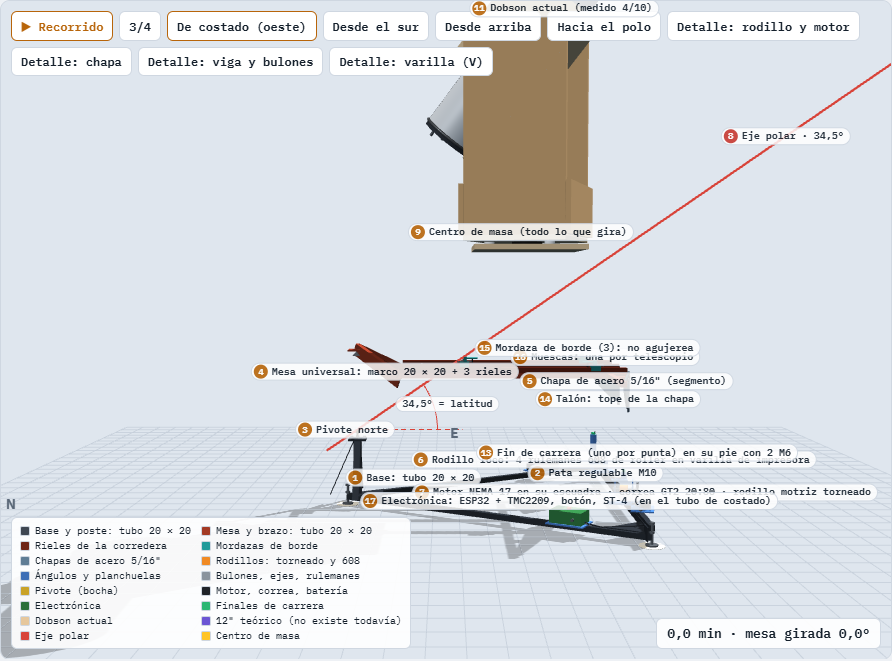

# El proyecto, todo en un lugar

**La guía general del telescopio.** Explica qué estamos haciendo, cómo
funciona, de qué está hecho, por qué se decidió cada cosa y qué falta. No baja
al detalle fino: para eso están los documentos de la carpeta «Para
profundizar» y el modelo 3D. Si alguien lee sólo un documento, que sea este.

Versión del 24 de octubre de 2026, a la noche. Lo que dice cómo venimos y qué
sigue está en el otro documento, «2 - Cómo venimos y cómo seguimos».

> **En una línea:** le vamos a poner abajo al dobson de 200 mm de Fran una
> plataforma que gira despacio, a la velocidad del cielo, para que una
> estrella se quede quieta en la foto durante 30 segundos sin guiar (y más
> tiempo con guiado). Con muchas fotos apiladas sale una nebulosa. La
> plataforma **viaja**: sirve en el patio y en cielos oscuros del centro del
> país.

## 1. La meta, y lo que no es la meta

- **La meta es la foto:** una imagen propia y apilada de una nebulosa o una
  galaxia, tomada con el telescopio de 200 mm, donde el objeto se reconozca y
  las estrellas sean puntos (no rayitas).
- **Se sigue apuntando a mano**, como hoy. No es un GoTo ni busca objetos
  solo: la plataforma nada más acompaña al cielo.
- **La montura dobson se conserva.** Es la única que hay: no se corta, no se
  agujerea, todo lo que se le agregue se tiene que poder sacar.
- **También tiene que llevar un dobson de 300 mm** (12") que todavía no
  existe, de cualquier marca, GoTo incluido, sin perder precisión. Se cambia
  de telescopio corriéndolo sobre unos rieles y apretando.
- **Sin notebook.** Una placa, un motor y una batería; para guiar, una
  Raspberry Pi pegada a la plataforma (eso no es una notebook).
- **Viaja** (Fran, 24/10): el 200 en un Clio, el 12" en camioneta, a cualquier
  lugar entre 30,5° y 38,5° de latitud (Córdoba, Mendoza, San Luis, El
  Leoncito, Mar del Plata). Y está pensada como una **tarjeta madre**: para ir
  al resto del país se cambian módulos (chapas, brazo, patas), no la
  plataforma.
- **El guiado va previsto desde el diseño:** fotos de 30 s sin guiar en
  cualquier lado, y de 2 a 4 minutos guiadas en un cielo oscuro.

## 2. El problema que resuelve

La Tierra gira, así que las estrellas se mueven en el cielo: 15 segundos de
arco por segundo de tiempo. Con el telescopio quieto, en una foto de 30 s cada
estrella se corre unos 450″, una raya larguísima. Para que sea un punto, el
telescopio tiene que girar igual que el cielo, sobre un eje paralelo al de la
Tierra (el **eje polar**, que acá apunta al polo sur celeste, 34,5° arriba del
horizonte).

Un dobson gira en altura y en azimut, no sobre el eje polar. La solución
clásica es la **plataforma ecuatorial**: una mesa baja que se pone debajo del
dobson y gira sobre el eje polar durante una hora, más o menos. Después se
rebobina y se sigue.

## 3. Cómo funciona: la plataforma VNS

Elegimos el tipo **VNS** (*vertical north segment*, en el hemisferio sur va
espejado: pivote al **norte**, chapas al **sur**). Ganó el estudio de
alternativas con los pesos que puso Fran (4,5 contra 2,7 del otro tipo, el de
segmentos circulares), porque se apoya en tres puntos, que nunca renguean, y
porque aguanta más peso.

- **La base** va al piso: un triángulo de tubo de hierro de 1,3 m, con **tres
  patas regulables** de 12 cm: nivelan y, inclinando la base entera, cambian
  la latitud ±4° sin tocar las chapas.
- **El pivote**, al norte: una bocha de acero templada en un cono. Es un
  punto del eje polar.
- **Dos chapas de acero** de 5/16" (8 mm), cortadas con una curva precisa,
  van colgadas de la mesa del lado sur. Apoyan en **dos rodillos** separados
  58 cm. La curva del canto de cada chapa es lo que hace que la mesa gire
  justo sobre el eje polar mientras rueda.
- **Un motor** paso a paso (NEMA 17) mueve la mesa. Una placa (ESP32 con un
  driver TMC2209) le da la velocidad del cielo, con una tabla que corrige lo
  que la geometría no hace perfecto.
- **La mesa** recibe al dobson: tres rieles norte-sur (la **corredera**) y
  tres **mordazas** que toman el borde de la base sin agujerearla.

**Cuánto dura una carrera:** 90 minutos de punta a punta (±45 min desde el
centro). Se usan 60 sin tocar nada; después, un botón la rebobina.

**Tres frenos independientes** para que la chapa nunca se salga del rodillo:
el programa para el motor a los 45 min, un fin de carrera corta la corriente
a los 48 (aunque el programa falle) y un talón de la chapa choca el rodillo a
los 51. Si se corta un cable, el motor también para.

## 4. El número que manda: el centro de masa

Para que el motor no tenga que sostener peso de más, **el centro de masa de
todo lo que gira tiene que caer sobre el eje polar** (a menos de 1 cm). La
altura de ese centro de masa define dónde va el dobson sobre la corredera.

**Medido el 17/10 por Fran:** el telescopio armado tiene el centro de masa a
**63,2 cm** del piso del dobson (± 0,5 cm). Pesa unos **40 kg** (tubo 19,2 y
montura 19,7). Se midió volcando la montura sin el tubo sobre sus cuatro
cantos hasta el equilibrio, y coincidió con la cuenta por partes: no hace
falta otro método.

Con la corredera, la forma de las chapas ya no depende de ese número (sirve
para cualquier centro de masa entre 50 y 65 cm): el número da la **muesca**
donde se fija el 200 en los rieles.

## 5. El 300 mm: la misma plataforma para los dos

La plataforma se diseña para la **envolvente** de los 12" del mercado: hasta
50 kg, centro de masa entre 50 y 62 cm, base de hasta 70 cm. Como el eje sube
hacia el sur, correr el dobson norte-sur pone cualquier centro de masa sobre
el eje: cada telescopio tiene su muesca. Chapas, rodillos, motor y base son
los mismos. Por eso la chapa es de 5/16" (la de 1/4" se marca con 50 kg), los
rodillos están a 58 cm y la base mide 1,3 m. **El vuelco y el empujón están en
revisión** (24/10): con la base inclinada para otra latitud y el empujón en la
boca real del tubo, el 12" queda sin margen. Se cierra antes de cortar nada.

## 6. Lo difícil: la precisión

Para que la estrella sea un punto, en 30 s la imagen no se puede correr más
de **2 segundos de arco** (un píxel de la cámara ve 0,67″). Ese margen se
reparte: 1,5″ la plataforma, 0,5″ la montura (que la madera no flexe) y la
puesta en estación (alinear el eje con el polo a menos de 7 minutos de arco,
sin ver el polo: en el sur no hay estrella polar útil). Se eligió 30 s el
24/10 porque nadie logró 60 s sin guiar con una plataforma y el cielo del
patio no los aprovecha.

Las cuentas encontraron dos cosas que mandan:

- **La pista** (el canto de la chapa y los rodillos) pide **micrones**. Un
  micrón de error en el canto mueve la estrella ≈ 0,27″. Un canto cortado a
  láser crudo no llega; hay que terminarlo (rectificado o electroerosión por
  hilo) y usar rodillos de una pieza rectificados (nada de cuatro rulemanes
  de roller en fila). Una muestra cortada y medida con comparador decide.
- **El motor**: un paso a paso cae en cada paso con hasta ±5 % de error.
  Con una sola correa eso estira la estrella. Por eso va ganando la
  transmisión **T2**: una varilla (tornillo de bolas) que empuja la mesa con
  una biela, la de la foto que mandó Fran. Otra opción es el rodillo con dos
  correas (F2). Se decide en su nivel, con una prueba de banco.

- **La corrección periódica (PEC)**: a 30 s ninguna transmisión entra sin
  ella (revisión del 24/10): el programa corrige el error que se repite en
  cada vuelta de la polea, del rodillo o del tornillo.

**El guiado** corrige lo lento en ascensión recta; en declinación no, y por
eso se le deja lugar en el pivote a un motor de declinación, que corrige bien
cerca del meridiano.

## 7. De qué está hecho y quién lo hace

| Parte | Material | Quién |
|---|---|---|
| Base, mesa y brazo | tubo de hierro 20 × 20 y planchuela, soldado; la viga sur abulonada | herrería de la casa (Fran y Kevin) o el amigo metalúrgico |
| Chapas | acero 5/16", corte láser + terminado del canto | servicio de corte (zona norte) y tornería |
| Rodillos | eje torneado y camisa rectificada sobre dos rulemanes | tornería con rectificadora (Munro) |
| Pivote | bocha templada en cono templado | compra |
| Motor y placa | NEMA 17 de 4 kg·cm, TMC2209, ESP32, batería | compra; el programa, la sesión |
| Mordazas, rieles, patas | planchuela, bulones M8 con mariposa | casa |

La vista explotada muestra cómo se arma por capas:

## 8. Cómo se usa, una noche

1. En el patio, apoyar la base sobre las **marcas del piso** (dos minutos).
   De viaje, ajustar las patas a la latitud y alinear el polo con la cámara
   (fotos en tres posiciones de la mesa, resueltas por computadora): unos 15
   minutos.
2. Subir la montura a la mesa (queda a ≈ 27 cm del piso), correrla a su
   muesca y apretar las tres mordazas. Poner el tubo.
3. Apuntar a mano, como siempre. Prender la plataforma.
4. Poner la cámara (Sony en foco primario; plan B, el celular en el ocular) y
   disparar subs de 30 s sin tocar el telescopio (guiados, más largos).
5. A la hora, botón de rebobinar, y otra carrera. Media hora de exposición
   por objeto ya da una nebulosa brillante (M42, la Laguna, Carina).

Lo que la noche pide además: cuidar el rocío, dejar enfriar el espejo,
enfocar con máscara de Bahtinov y no dejar la pista con óxido ni polvo.

## 9. Las fases, a la NASA

El proyecto sigue las fases de un proyecto de la NASA, achicadas:

| # | Fase | En criollo | Estado |
|---|---|---|---|
| 0 | Pre-Fase A, estudio de conceptos | ver qué se puede hacer y elegir | **en curso**: falta cerrar la revisión independiente, el ConOps y las medidas de Fran |
| 1 | Fase A, requisitos y presupuesto de error | **el trazador**: la plataforma cruda andando en el patio con fotos de 10-15 s; con lo medido en ella se fijan los números | sin empezar |
| 2 | Fase B, reforma de la montura | dejar la montura lista y medida | sin empezar |
| 3 | Fase C, diseño de detalle | planos para cortar, lista de compras | sin empezar |
| 4 | Fase D, construir y probar | armarla y medir que sigue una estrella | sin empezar |
| 5 | Fase E, operar | **la foto** | sin empezar |

**Los requisitos** son el papel que define el proyecto: una necesidad y 13
expectativas de Fran bajan a 88 requisitos (qué tiene que lograr la misión, el
sistema y cada parte), cada uno con cómo se va a comprobar. El modelo y los
planos se comparan contra esa lista, nunca al revés. Viven en el repositorio
(`docs/10-requisitos.md`, versión 0.3).

**Las compuertas para cerrar la etapa 0** (Fran, 24/10: «no puede haber
ningún error de concepto»): una **revisión independiente** —una sesión que no
escribió el concepto rehace cada cuenta— sin hallazgos abiertos, y el ConOps al
día. **Nada de la plataforma se corta ni se compra** antes de eso y de la
prueba de foco. La primera revisión encontró 6 errores de concepto, que se
están corrigiendo (documento 6 de «Para profundizar»).

## 10. Los riesgos que más pesan

- **Que la cámara no llegue a foco** (falla clásica de los newtonianos). Se
  sabe en 10 minutos de día. Si no llega, el plan B es el celular o una
  Barlow; si tampoco, el proyecto se replantea. Por eso va antes de comprar
  nada caro.
- **Que la pista no dé los micrones.** Lo decide una muestra de chapa, antes
  de cortar las del trazador.
- **Un error de concepto que nadie vio.** Por eso la revisión independiente y
  el trazador: lo que una revisión no ve, lo muestra la plataforma cruda antes
  de gastar en precisión.
- **Que la montura flexe** al girar la mesa: se mide en la fase 2.
- **La noche:** rocío, frío en el foco, óxido en el canto.

## 11. Dónde está todo

- **El modelo 3D**, para girarlo y ver cada pieza (versión 10.6, con el
  centro de masa medido): https://claude.ai/artifact/K4hfyQRik4xsJYYXv5sFeM
  (público con el link). El link viejo (Sn7F7…) quedó en la 10.5.
- **Cómo venimos, qué falta y qué comprar:** el documento 2 de esta carpeta.
- **Para profundizar** (la carpeta del mismo nombre): mecanismos y
  proveedores, qué puede salir mal, los planos preliminares, **la lluvia de
  ideas y revisión del concepto (5)** y **la revisión independiente (6)**, del
  24/10. No hace falta leerlos para entender el proyecto.
- **Historial** (la otra carpeta): lo que ya se usó o quedó reemplazado
  (cómo se midió el centro de masa, el protocolo, el cuaderno viejo) y las
  fotos de la montura.
- **La fuente de todo** es el repositorio: estos documentos se regeneran
  desde ahí; no se editan a mano.
