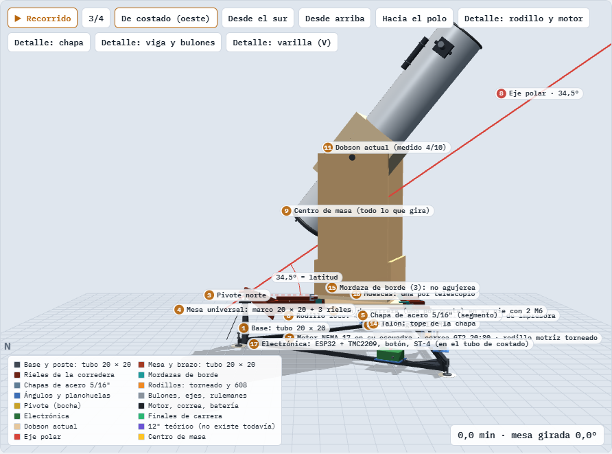
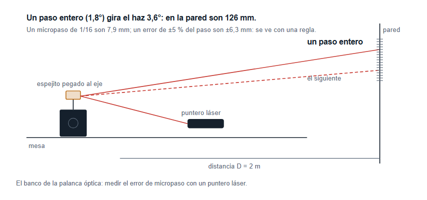

# Cómo venimos y cómo seguimos

**En criollo, sin vueltas.** Qué ya está, qué falta sí o sí para cerrar la
primera etapa, qué se puede ir comprando y en qué orden sigue. El proyecto
entero explicado está en «1 - El proyecto, todo en un lugar».

Actualizado el 24 de octubre de 2026.

## Cómo venimos

> **Lejos de la foto, pero con la primera etapa casi cerrada.** De las seis
> etapas del plan (elegir, fijar los números, reformar la montura, dibujar
> para cortar, construir, sacar la foto) estamos terminando la primera. A
> ojo, un 10-15 % del camino.

Lo que ya está y no se vuelve a discutir:

- **Qué plataforma:** la VNS (pivote al norte, dos chapas al sur). La
  eligió Fran con sus pesos, y no empató con nada.
- **Que sirva para el 200 y para un 12":** mesa con rieles, cada telescopio
  en su muesca, mismas chapas y mismo motor.
- **La lista de requisitos**, escrita y chequeada: es el papel contra el que
  se compara todo.
- **El centro de masa, medido** (17/10): 63,2 cm del piso del dobson. El
  vuelco salió de diez y coincidió con la cuenta por partes. La base fija
  mide 43 × 43.
- **El diseño preliminar en 3D, ya con esas medidas** (versión 10.6, 24/10):
  la muesca del 200 queda a 2,5 cm al norte; todo armado, nada flotando y
  nada que choque en toda la carrera. Vuelco y empujón, en verde con los dos
  telescopios.

## Lo que falta sí o sí para cerrar la primera etapa

Son cuatro cosas. Las tres primeras son tuyas; sin ellas la revisión del
concepto no se puede hacer bien.

### 1. La prueba de foco con la Sony — 10 minutos, de día

**Por qué:** es la falla clásica de los newtonianos: el portaocular no tiene
recorrido para adentro y la cámara no llega a foco. Si no llega, cambia el
plan antes de gastar un peso en chapa.

**Cómo:**
1. La Sony **sin lente**, con su adaptador, en el portaocular.
2. Apuntá a algo lejos, a más de 200 m (una antena, un edificio).
3. Girá el portaocular de punta a punta mirando la pantalla.
4. Anotá: **¿se ve nítido? sí o no.** Si no: ¿mejora yendo para adentro o
   para afuera, y se acaba el recorrido antes? Sacale una foto a la pantalla
   en el mejor punto.

**Qué pasa con cada respuesta:** sí → seguimos como está. No, y le falta
para adentro → una Barlow o correr el espejo. Tampoco con el celular en el
ocular → se replantea (muy improbable: el celular enfoca solo).

### 2. El inventario, con calibre — 1 hora

**Por qué:** cerrar la primera etapa pide que no quede ninguna pieza con un
«creo que es». Y es lo que dice qué hay que comprar.

**Qué:** una foto de cada cosa **donde se lea la etiqueta**, y la medida al
lado.
- **Hierros:** de cada tubo, ángulo y planchuela: la sección, el espesor de
  pared (con el calibre) y cuántos metros hay.
- **Lo rescatado de la impresora:** cuántos rulemanes de roller (¿dicen
  608?), las varillas lisas (¿miden 8,00 mm?) y su largo, los microswitches.
- **Lo que faltaba anotar:** la balanza (marca, hasta cuánto pesa, de cuánto
  en cuánto), la placa «HW-130» por los dos lados, mariposas y bulones M8.
- **Los NEMA de tu amigo:** la foto de la etiqueta de cada uno (ver la
  compra, abajo: con eso se elige cuál).
- **La casetera ya está vista** (5/10): sus dos motores son de continua y no
  sirven para seguir el cielo. No hace falta volver a inventariarla.

### 3. Una decisión tuya: ¿60 s sin guiar, o no?

La investigación del 9/10 encontró que **nadie documenta fotos de 60 s sin
guiar** con una plataforma a 1200 mm: pide una pista (el canto de la chapa y
los rodillos) con errores de 1 a 2 milésimas de milímetro, que un corte láser
no da. Hay tres caminos:

| Camino | Qué cambia | Costo |
|---|---|---|
| **(a)** fotos de **30 s** | el papel pide la mitad de precisión; el resto del diseño queda igual | nada |
| **(b)** **guiado en un eje** (la entrada ya está en el diseño) | suma una camarita guía; hoy un requisito dice «sin autoguiado» y habría que cambiarlo | una cámara guía y algo que la maneje de noche |
| **(c)** **pista mecanizada** (canto por electroerosión, rodillos rectificados) | se mantienen los 60 s | lo más caro; hay que cotizar |

**Lo que recomienda la sesión:** (a) como base, y (b) como la segunda etapa
que ya estaba en el plan (subs largos con autoguiado). Es lo más barato, se
puede deshacer (es cambiar un número en el papel) y no cierra ninguna puerta.
La muestra del canto (más abajo) dice después si se puede volver a 60 s sin
guiar. **Decidís vos**: es una elección de valor, no técnica.

### 4. La revisión del concepto (la «MCR») — la sesión, con vos

Con 1, 2 y 3, la sesión arma la revisión de cierre: frena, mira el proyecto
desde arriba (y busca afuera lo que otros ya resolvieron), y te muestra el
concepto terminado para que digas «sí, este». Ahí se cierra la primera etapa
y se abre la segunda.

**Lo que NO hace falta para cerrarla:** elegir la transmisión (tornillo o dos
correas: se decide en la etapa siguiente, con la palanca óptica) ni la
muestra del canto. Las dos preguntas del final se pueden contestar en la
misma revisión.

## Lo que podés comprar ya

Todo esto sirve **gane la transmisión que gane**, y casi todo te queda para la
facu (el cohete de agua, Software de Vuelo, el Taller). Los precios no están
cotizados: la columna de la derecha es cómo buscarlo.

### Para el telescopio (y para el banco del motor)

| Qué | Cuántos | Para qué | Cómo buscarlo |
|---|---|---|---|
| **Motor NEMA 17**, 1,8°, de unos 40 a 48 N·cm (4 a 5 kg·cm), 1,5 a 2 A, cuerpo de 40 a 48 mm, eje de 5 mm, 4 cables | 1 (2 si te los deja bien) | el motor de la plataforma, y el del banco de la palanca óptica | a tu amigo: que la etiqueta diga algo como **17HS4401, 17HS4401S o 17HS8401** y 40 N·cm o más. No sirven los chatos de 20-23 mm (17HS2408: 1,6 kg·cm) |
| **Driver TMC2209** (v1.2 o v1.3) | 2 | uno para la plataforma y uno de repuesto o para la facu | «TMC2209 v1.3» |
| **ESP32 DevKit** (ESP32-WROOM-32, 30 o 38 pines) | 2 | la placa de la plataforma (botón, entrada de guiado, el Bluetooth de Kevin) y la facu | «ESP32 devkit v1» |
| Capacitor electrolítico **100 µF 35 V** | 4 | uno pegado a cada TMC2209: sin él, el pico de tensión al prender lo puede quemar | casa de electrónica |
| **Microswitch con palanca de rodillo** (KW12 o V-156) | 3 | los dos fines de carrera y uno de repuesto | «microswitch rodillo KW12» |
| Puntero láser chico y un espejito | 1 | la palanca óptica, que decide la transmisión | — |

### Para la facu, y de uso general

| Qué | Cuántos | Para qué |
|---|---|---|
| **ESP32-C3 SuperMini** | 2 | la placa del cohete de agua: chica y barata |
| **BMP280** (módulo GY-BMP280, I2C) | 2 | presión y altura (el sensor del cohete) |
| **BME280** | 1 | lo mismo, más humedad: en el telescopio avisa cuándo viene el rocío. Ojo: muchos «BME280» baratos son BMP280; se ve con el número de chip al leerlo |
| **Pantalla OLED 0,96"** 128×64, I2C, SSD1306, 4 pines | 2 | la del cohete, y la pantalla que quería Kevin para la plataforma |
| **MPU6050** (GY-521) | 1 | aceleración y giro, para Software de Vuelo |
| Módulo **microSD** | 1 | guardar los datos de un vuelo |
| **Servo MG90S** (engranajes de metal) | 2 | los paracaídas del cohete |
| Conversor de niveles 3,3 / 5 V (BSS138, 4 canales) | 2 | conectar módulos de 5 V a placas de 3,3 V |
| Protoboard de 830 puntos | 2 | — |
| Cables dupont macho-macho, macho-hembra y hembra-hembra | 40 de cada | — |
| Placa perforada 5×7 y 7×9, tiras de pines macho y hembra, borneras de tornillo de 2 y 3 | un par de cada | pasar del protoboard a algo que no se desarma |
| Kit de resistencias, kit de capacitores, LEDs, pulsadores | uno | — |
| MOSFET **IRLZ44N** | 5 | prender cosas de 12 V desde la placa (los calefactores contra el rocío) |
| Diodos 1N5819 y cable de silicona de 22 AWG | 10 y unos metros | — |

### Para usar la fuente de PC

La fuente sirve, y de sobra: da 12, 5 y 3,3 V. Le faltan tres cosas:

| Qué | Por qué |
|---|---|
| **Adaptador de fuente ATX a bornes** («ATX breakout board 24 pines», con llave) | saca 12, 5 y 3,3 V a bornes y la prende sin puentear el cable verde |
| **Step-down regulables**: 3 LM2596 (3 A) y 2 MP1584 chiquitos | bajan los 12 V a lo que pida cada placa |
| **Portafusible y fusibles** de 2 y 5 A | la fuente da 15 a 40 A en los 12 V: un corto derrite cables antes de que ella se corte |

**Si no tenés:** soldador de 60 W con temperatura regulable, estaño de 0,8 mm
con flux y malla desoldadora.

**En el patio no va la fuente de PC** sino una batería de 12 V; se elige
después de medir en el banco cuánto consume el motor (ahí sale cuántos
amperes-hora).

### Lo que todavía NO se compra

La chapa y su corte (después de la prueba de foco y de la muestra del
canto); correas, poleas y tornillo de bolas (dependen de la transmisión);
rulemanes (tenés los del roller); la batería de campo.

## Cómo seguimos, en orden

| # | Qué | Quién | Por qué va ahí |
|---|---|---|---|
| 1 | Prueba de foco | Fran | si falla, cambia todo lo demás |
| 2 | Inventario (con las etiquetas de los NEMA) | Fran | cierra la etapa y confirma las compras |
| 3 | Decidir 30 s, guiado o pista mecanizada | Fran | fija el número que manda toda la precisión |
| 4 | Revisión del concepto | la sesión, con Fran | cierra la primera etapa |
| 5 | El motor en el banco, y la **palanca óptica** (un láser en el eje del motor que dibuja en la pared cuánto se equivoca cada paso) | Fran y Kevin, una tarde, con lo comprado | decide la transmisión con datos y no con catálogo |
| 6 | La muestra del canto: un pedacito de chapa de 5/16" cortado a láser, medido con un comparador milesimal | Fran, con el láser y una tornería | dice si se puede volver a 60 s sin guiar |
| 7 | Fijar los números que faltan y cerrar las cuentas del error | la sesión | eso es la segunda etapa |

Las compras y los pasos 5 y 6 pueden ir en paralelo con el 1, el 2 y el 3.

## Dos preguntas que siguen abiertas, y son tuyas

1. **¿La plataforma se queda en el patio, o viaja en auto a un cielo
   oscuro?** Si viaja: qué auto, o cuánto mide el baúl. Decide en cuántas
   piezas se desarma. Dato: Punta Indio (150 km, cielo oscuro) sirve sin
   cambiar nada.
2. **¿Cuánto armado te parece bien,** del depósito a la primera foto? Hoy el
   papel dice 20 minutos.

## Lo que NO se hace todavía

No se corta, no se suelda y no se compra nada grande. Los planos que hay son
de disposición, para entender el conjunto: **no son para cortar**. Se corta
recién con los planos de la cuarta etapa, que salen de los números medidos.
